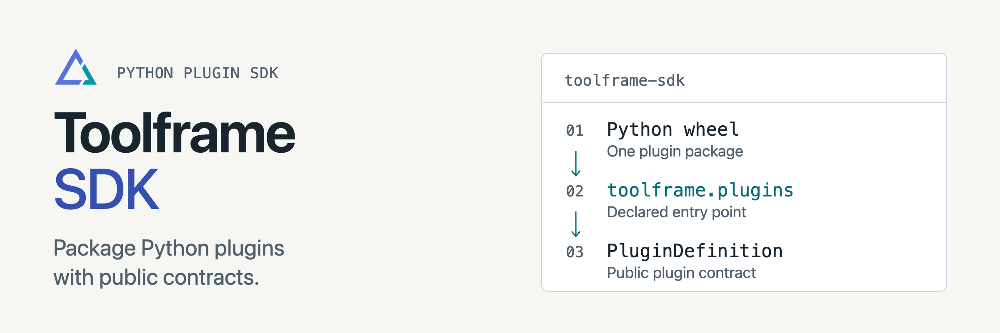

<p align="center">
<picture>
  <source media="(prefers-color-scheme: dark)" srcset="docs/assets/readme-banner-dark.png">
  <source media="(prefers-color-scheme: light)" srcset="docs/assets/readme-banner-light.png">
  
</picture>
</p>

# Toolframe SDK

[](https://github.com/toolframe/toolframe-sdk/actions/workflows/ci.yml?query=branch%3Amain)

Define Toolframe plugins, services and presentation resources in Python.
The SDK supplies scoped storage clients and the worker protocol shared by Core and providers.

## Quick start

Use Python 3.14+:

```sh
python -m pip install toolframe-sdk==0.4.1
```

A plugin definition names its factory and declares its permissions:

```python
from toolframe_sdk import AuthorizationSpec, Plugin, PluginDefinition


class ExamplePlugin(Plugin):
    pass


plugin = PluginDefinition(
    id="example",
    factory="example:ExamplePlugin",
    authorization=AuthorizationSpec(),
)
```

Save this as `example.py`. To package a usable service, start with
`toolframe --home APP plugin new my-plugin` using the separately installed
[Toolframe CLI](https://github.com/toolframe/toolframe-core#readme), then follow [plugin authoring](https://github.com/toolframe/toolframe-core/blob/main/docs/authoring.md).

**Scope:** the SDK is a library; Core runs applications and enforces admission.
It imports neither Core nor Streamlit/FastMCP. Plugins declare a minimum SDK and
allow compatible updates under the [compatibility policy](docs/compatibility.md).

## Guides

| I want to… | Start here |
| --- | --- |
| Declare permissions and resources | [Plugin and worker contracts](docs/contracts.md) |
| Store data | [SQL](docs/storage.md) · [Objects](docs/object-storage.md) |
| Build HTML apps or templates | [Web](docs/web.md) · [Authoring helpers](docs/authoring.md) |
| Run background work and diagnostics | [Tasks](docs/tasks.md) · [Logging](docs/logging.md) · [Tracing](docs/tracing.md) |
| Test a plugin | [Testkit](https://github.com/toolframe/toolframe-testkit) |
| Contribute or run checks | [Contributing](CONTRIBUTING.md) · [Verification](docs/ci.md) |

[Releases](https://github.com/toolframe/toolframe-sdk/releases)

## License

[Apache 2.0](LICENSE), with [NOTICE](NOTICE).
